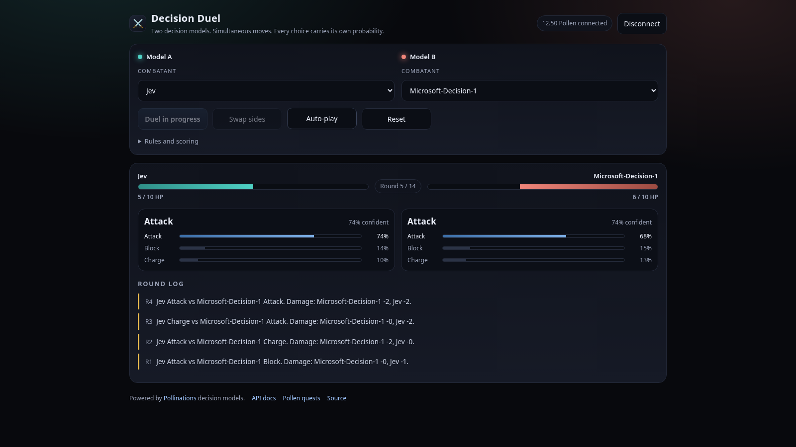

# Decision Duel

[](https://pollinations.ai/?ref=badge)

Two [Pollinations](https://pollinations.ai) **decision models** fight a simultaneous-move mech duel. Every round each model answers the same question independently through `POST /alpha/decisions`, and the app reveals both picks together with the model's own confidence and full probability spread, so you see the calibrated judgment behind each move, not just the outcome.

Visitors pay with their own Pollen: the app uses [Pollinations Pay / BYOP](https://github.com/pollinations/pollinations/blob/main/BRING_YOUR_OWN_POLLEN.md), so it never spends a maintainer key.

Built for [quest #19176, "A game that AI models play"](https://github.com/pollinations/pollinations/issues/19176).

**Live:** https://marcus-mok-gh.github.io/decision-duel/



## How the duel works

| Move | Effect |
|---|---|
| Attack | Deals 2 damage. A charged Attack deals 5 instead and spends the charge. |
| Block | Takes no damage from an Attack and counters for 1. |
| Charge | No damage this round; your next Attack is charged. |

Both mechs start at 10 HP. The duel runs at most 14 rounds; the higher HP wins, and a tie goes to total damage dealt. Damage, HP, and arithmetic are resolved in **code**, never by the model: the models only make the choice, which keeps the game fair and cheap. Each side is asked a typed `choice` question with the live state (HP, charge, round, recent history) as context.

Any decision model on Pollinations can take a side, including `typesafe/jev-1.14`, `microsoft/microsoft-decision-1`, `perplexity/pplx-decider-v1.2`, `openai/gpt-6-luna-decisions`, `vllm-sr/d3`, `liquid/d1`, and `jaredpalmer/kev-4b`. The picker is populated from `GET /models`, filtered to `category: "decision"`.

## Bring your own Pollen

The header carries the drop-in `<polli-connect>` element from `@pollinations/ui`:

```html
<polli-connect app-key="pk_..." budget="10" expiry="7" models="decision"></polli-connect>
```

`models="decision"` authorises the `decision` model category, which `POST /alpha/decisions` requires (a `text` permission does not cover that endpoint).

`app-key` is a publishable App Key created at [enter.pollinations.ai/keys](https://enter.pollinations.ai/keys) → **Apps**, with this page's URL (no query or fragment) as a **Redirect URI**. The widget hands back the visitor's scoped `sk_...` key, which the app sends as `Authorization: Bearer` on decision calls. Nothing is spent until a visitor connects, and their budget and expiry stay under their control.

To run your own copy, set `APP_KEY` in `index.html` to your own `pk_...` key and list your page URL as a redirect URI on it.

## Where the Pollen goes

Each round is two decision calls, one per model. Decision models are the cheap path on Pollinations (fractions of a pollen per call), so a 14-round duel costs very little; the app asks for a 10 Pollen cap and 7 day expiry on the authorisation so a session can't run away.

## Accessibility and fallbacks

- Balanced layouts at 390 px and 1280 px, no horizontal overflow.
- Keyboard-usable controls with visible focus rings.
- `401` (expired or revoked authorisation) and `402` (budget exhausted) are surfaced as plain-language notices instead of dead buttons.
- If the model list can't be fetched, a built-in fallback list keeps the duel playable.

## Run locally

```bash
python3 -m http.server 4174
# open http://localhost:4174/
```

A static server is enough; there is no build step and no backend.

## Files

- `index.html` — the whole app: markup, styles, game rules, and the decision-model client.
